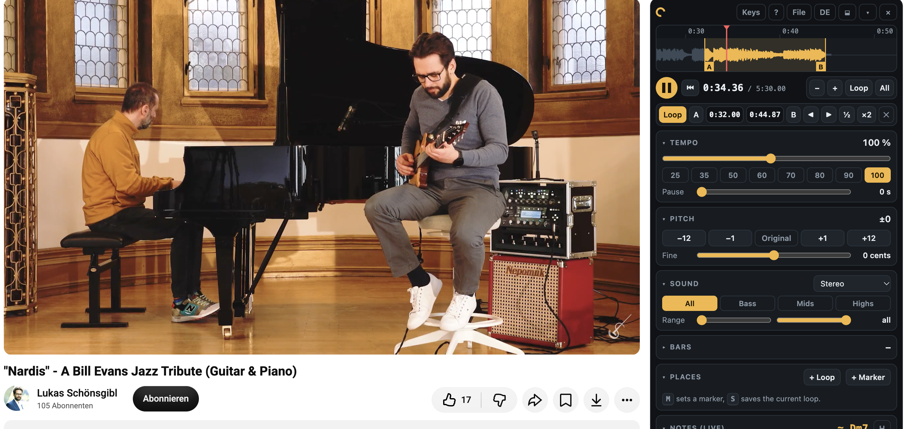
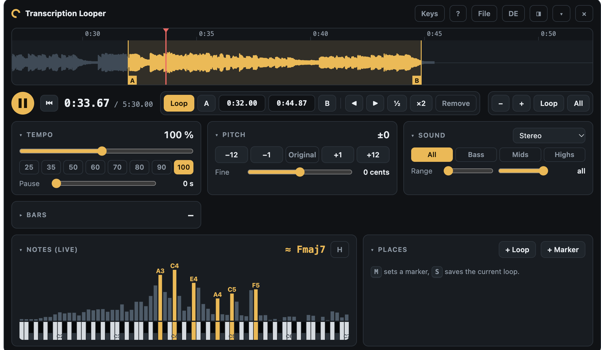
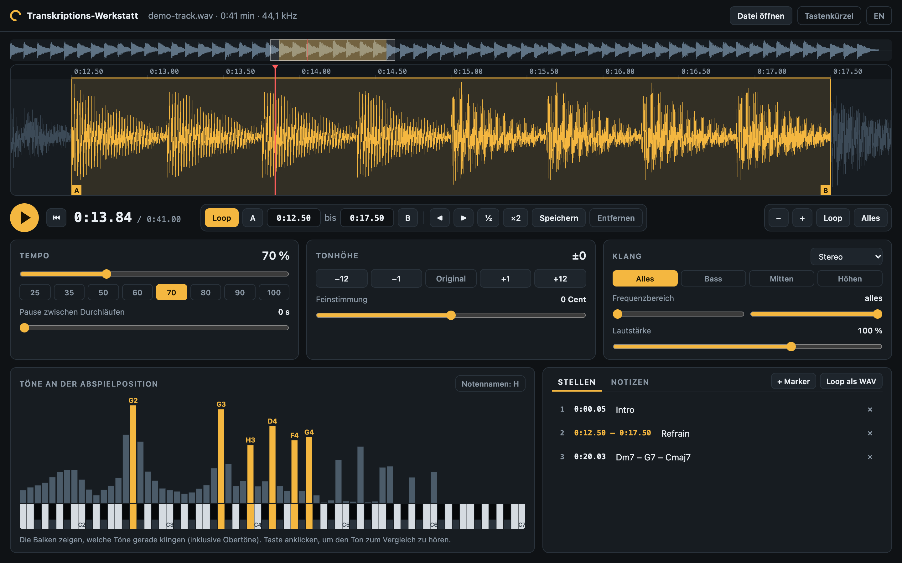

# Transkriptions-Looper

**Eine Chrome-Erweiterung zum Heraushören und Transkribieren.** Eine Stelle in einem YouTube-Video oder einer Audiodatei präzise loopen, ohne Tonhöhenänderung verlangsamen, transponieren, den Bass herausfiltern und sehen, welche Töne klingen – alles im Browser, nichts wird hochgeladen.

[English version](README.md) · [Neueste Version herunterladen](https://github.com/hybridpicker/youtube-transcription-looper/releases/latest) · [Änderungen](CHANGELOG.md)

Sie besteht aus zwei Teilen:

- **YouTube-Looper**: ein Bedienfeld direkt neben dem Video mit präzisem A/B-Loop, Zeitlupe, Transposition, Klangfilter, Taktraster, Live-Tonanzeige und gespeicherten Stellen.
- **Transkriptions-Werkstatt** für Audiodateien: dieselben Werkzeuge mit echter Wellenform und samplegenauen Loops.

Die Oberfläche gibt es auf **Englisch** und **Deutsch**. Sie richtet sich nach der Browsersprache; der Knopf `EN` / `DE` schaltet um.

## Funktionen

- **A/B-Loop**: Bereich in der Zeitleiste aufziehen, Grenzen fein verschieben, Loop um seine Länge weiterschieben, halbieren oder verdoppeln, Pause zwischen den Durchläufen.
- **Zeitlupe von 10 bis 200 %** bei gleicher Tonhöhe, auch unter YouTubes Grenze von 25 %, mit einem Phase-Vocoder, der auch bei langsamen Tempi sauber klingt.
- **Tonhöhe** ±12 Halbtöne und Feinstimmung in Cent, unabhängig vom Tempo.
- **Klang**: nur linker oder rechter Kanal, Mono, Mitte entfernt (dämpft oft Gesang oder Solo), und ein Frequenzbereich, z. B. nur Bass.
- **Taktraster**: Tempo tippen, die Eins setzen, Taktnummern in der Zeitleiste; ein Loop lässt sich als „Takt 5 bis 8“ setzen.
- **Töne live**: Eine Klaviatur zeigt, welche Töne klingen, und schätzt den Akkord. Ein Klick auf eine Taste spielt den Ton.
- **Stellen**: benannte Marker und gespeicherte Loops, pro Video oder Datei gemerkt.
- **Extras der Werkstatt**: samplegenaue Loops ohne Knackser, Notizen mit Zeitmarken, Export des aktuellen Loops als WAV.
- **Datenschutz**: kein Konto, kein Tracking, keine eigenen Netzwerkanfragen. Siehe [PRIVACY.md](PRIVACY.md).

## Installation

Die Erweiterung ist (noch) nicht im Chrome Web Store. Die Installation dauert eine Minute:

1. `transcription-looper-<version>.zip` aus der [neuesten Version](https://github.com/hybridpicker/youtube-transcription-looper/releases/latest) herunterladen und entpacken.
2. In Chrome `chrome://extensions` öffnen.
3. Oben rechts den **Entwicklermodus** aktivieren.
4. **Entpackte Erweiterung laden** anklicken und den entpackten Ordner auswählen.
5. Das Symbol der Erweiterung in der Symbolleiste anheften.

Sie läuft in Chrome und anderen Chromium-Browsern (Edge, Brave, Vivaldi, Arc).

**Aktualisieren:** neue Version herunterladen, den Inhalt des Ordners ersetzen und in `chrome://extensions` auf der Karte der Erweiterung auf das Aktualisieren-Symbol klicken. Offene YouTube-Tabs danach neu laden.

**Aus dem Quellcode:** dieses Repository klonen und in Schritt 4 den Repository-Ordner wählen.

## YouTube-Looper

Auf einer YouTube-Videoseite das Symbol der Erweiterung anklicken: Das Bedienfeld erscheint rechts neben dem Video, sodass Bild und Regler gleichzeitig sichtbar sind, und bleibt beim Scrollen stehen. Es bleibt für weitere Videos geöffnet, bis du es mit `×` schließt.

Der Knopf `⬓` in der Kopfzeile setzt das Bedienfeld stattdessen unter das Video (und `◨` wieder zurück). Im Kinomodus und in schmalen Fenstern ohne Seitenleiste landet es automatisch unter dem Video. Jeder Abschnitt (Tempo, Tonhöhe, Klang, Takte, Stellen, Töne) lässt sich mit einem Klick auf seine Überschrift einklappen. Auf jeder anderen Seite öffnet das Symbol die Werkstatt für Audiodateien.

| Bereich | Was er kann |
| --- | --- |
| Zeitleiste | Klick springt, Ziehen zieht einen Loop auf, die Griffe A/B lassen sich verschieben. Ein neuer Loop wird automatisch herangezoomt; **Alles** zeigt wieder das ganze Video, `Strg`/`⌘` + Mausrad zoomt frei. Die Wellenform entsteht beim Abspielen und zeigt, was du schon gehört hast. |
| Loop | Um die eigene Länge weiter/zurück springen, halbieren, verdoppeln, Grenzen fein verschieben, Pause zwischen den Durchläufen. `✕` entfernt den Loop. |
| Tempo | 10–200 % bei gleicher Tonhöhe. Ein Klick auf die Prozentzahl setzt auf 100 % zurück. |
| Tonhöhe | ±12 Halbtöne und Feinstimmung in Cent, unabhängig vom Tempo. |
| Klang | Kanalwahl (links, rechts, Mono, Mitte entfernt) und Frequenzbereich, z. B. nur Bass. |
| Takte | Taktraster in der Zeitleiste mit Taktnummern; Loop-Grenzen lassen sich frei setzen (mit `Alt` rasten sie auf Schläge und Takte ein), und ein Loop lässt sich direkt als „Takt 5 bis 8“ setzen. |
| Stellen | Marker (**+ Marker**) und gespeicherte Loops (**+ Loop**) mit Namen, pro Video gemerkt. |
| Töne | Zeigt live über einer Klaviatur, welche Töne klingen, und schätzt den Akkord. Ein Klick auf eine Taste spielt den Ton zum Vergleich. |

Loop, Tempo, Tonhöhe, Raster, Stellen, Zoom und die bisher gehörte Wellenform werden pro Video gespeichert; nach einem Reload (auch im YouTube-App-Fenster) geht es dort weiter.

Die Tastenkürzel sind dieselben wie in der Werkstatt (siehe unten), dazu `T` (Tempo tippen), `X` (Eins setzen) und `G` (Raster ein/aus). Solange das Bedienfeld offen ist, haben sie Vorrang vor YouTubes eigenen Tasten; der Knopf **Tasten** schaltet das aus.

### Takte markieren

Der Abschnitt **Takte** ist anfangs eingeklappt; ein Klick auf die Überschrift öffnet ihn.

1. **Tempo festlegen:** Video laufen lassen und im Takt auf **Tippen** klicken (oder `T` drücken), mindestens zwei, besser acht Schläge. Alternativ das Tempo als BPM eintragen. Das funktioniert auch bei verlangsamter Wiedergabe; das Tempo bezieht sich immer auf das Original.
2. **Eins setzen:** An der ersten Zählzeit von Takt 1 auf **1 hier** klicken (oder `X`). Mit `◂` `▸` lässt sich das Raster um 10 ms verschieben (`Shift`: 50 ms).
3. **Taktart:** Schläge pro Takt wählen (Standard 4).

Danach zeigt die Zeitleiste Taktstriche mit Nummern statt Zeiten, beim Hineinzoomen auch die Schläge, und oben rechts im Abschnitt steht der aktuelle Takt und Schlag. Loop-Grenzen landen genau dort, wo du sie setzt; mit `Alt` beim Ziehen rasten sie auf Schläge und Takte ein, **Raster** (`G`) blendet alles aus. Ein Loop, der auf Taktgrenzen liegt, springt mit `,` und `.` taktweise weiter.

Das Raster ist gleichmäßig. Bei Aufnahmen mit schwankendem Tempo läuft es mit der Zeit auseinander; dann die Eins am jeweiligen Abschnitt neu setzen.

### So funktioniert die Klangbearbeitung

Für Zeitlupe und Transposition wird der Ton des Videos durch einen eigenen Phase-Vocoder geleitet statt durch Chromes eingebaute Tempokorrektur. Das klingt bei langsamen Tempi deutlich sauberer, bringt aber eine kleine Verzögerung des Tons gegenüber dem Bild mit (etwa 0,1 s, bei sehr langsamem Tempo bis 0,35 s). Bei 100 % und Originaltonhöhe läuft der Ton unverändert und ohne Verzögerung.

### Gut zu wissen

- Die Klangbearbeitung (Tonhöhe, Filter, Tonanzeige, Wellenform) startet von selbst, sobald Chrome es erlaubt: auf YouTube meist sofort, sonst nach dem ersten Klick oder Tastendruck auf der Seite. Bis dahin funktionieren Loop und Tempo bereits.
- Beim Sprung zum Loop-Anfang macht der YouTube-Player eine winzige Pause. Für nahtlose, samplegenaue Loops ist die Werkstatt mit einer Audiodatei besser geeignet.
- Während Werbung greift der Looper nicht ein.
- Im Vollbildmodus ist das Bedienfeld nicht sichtbar; Loop und Tastenkürzel laufen weiter.
- Wird die Erweiterung neu geladen, während ein YouTube-Tab offen ist, den Tab neu laden.

## Transkriptions-Werkstatt (Audiodateien)

Öffnen: Erweiterungs-Symbol auf einer beliebigen Nicht-YouTube-Seite anklicken, oder im YouTube-Bedienfeld **Datei**. Danach eine Datei in das Fenster ziehen (MP3, WAV, FLAC, M4A, OGG; auch Videodateien mit Tonspur).

| Bereich | Was er kann |
| --- | --- |
| Wellenform | Klick springt, Ziehen zieht einen Loop auf, die Griffe A/B lassen sich verschieben. Mausrad zoomt, seitliches Wischen verschiebt. Die Leiste darüber zeigt die ganze Datei. |
| Loop | Samplegenaue Grenzen ohne Knackser. Um die eigene Länge weiter/zurück springen, halbieren, verdoppeln, Pause zwischen den Durchläufen. |
| Tempo | 10–200 % bei gleicher Tonhöhe. Bei 100 % und Originaltonhöhe wird die Datei unverändert abgespielt. |
| Tonhöhe | ±12 Halbtöne und Feinstimmung in Cent, unabhängig vom Tempo. |
| Klang | Kanalwahl (links, rechts, Mono, Mitte entfernt), Frequenzbereich und Lautstärke. |
| Töne | Zeigt über einer Klaviatur, welche Töne an der Abspielposition klingen, und schätzt den Akkord. Ein Klick auf eine Taste spielt den Ton zum Vergleich. |
| Stellen | Marker und gespeicherte Loops mit Namen; Aufruf per Klick oder Zifferntaste. |
| Notizen | Textfeld pro Datei mit Zeitmarken, Export als Textdatei. Der aktuelle Loop lässt sich als WAV speichern. |

Loop, Tempo, Marker und Notizen werden pro Datei gemerkt. Die zuletzt geöffnete Datei wird beim nächsten Start wieder geladen (lokal im Browserspeicher der Erweiterung).

### Tastenkürzel

| Taste | Funktion |
| --- | --- |
| `Leertaste` | Wiedergabe / Pause; bei aktivem Loop beginnt die Wiedergabe immer am Loop-Anfang |
| `Enter` | Zum Loop-Anfang springen und abspielen |
| `←` `→` | 1 s zurück / vor (`Shift`: 5 s, `Alt`: 0,1 s) |
| `A` `B` | Loop-Anfang / -Ende an der Abspielposition |
| `L` | Loop ein / aus |
| `,` `.` | Loop um seine Länge zurück / weiter |
| `H` `D` | Loop halbieren / verdoppeln |
| `Q` `W` / `E` `R` | Loop-Anfang / Loop-Ende früher / später (`Shift`: grob) |
| `↑` `↓` | Tempo ±5 % |
| `+` `−` | Tonhöhe ±1 Halbton |
| `M` / `S` | Marker setzen / Loop speichern |
| `1`–`9` | Gespeicherte Stelle aufrufen |
| `Z` / `F` | Auf den Loop zoomen / ganze Datei zeigen |
| `?` | Tastenkürzel anzeigen |

Im Notizfeld: `Shift`+`Leertaste` Start/Pause, `Shift`+`Enter` zum Loop-Anfang, `Alt`+`T` Zeitmarke.

### Gut zu wissen

- Die Akkordanzeige ist eine Schätzung aus dem Spektrum und kann durch Obertöne danebenliegen. Unter etwa A1 ist die Tonauflösung grob.
- Sehr lange Dateien brauchen viel Arbeitsspeicher, weil sie vollständig dekodiert werden (etwa 25 MB pro Stereo-Minute).
- Ohne Erweiterung lässt sich die Werkstatt auch über einen lokalen Webserver öffnen: im Projektordner `python3 -m http.server 8791` starten und `http://localhost:8791/app/` aufrufen. Ein Doppelklick auf `index.html` genügt nicht.

## Notennamen

Die Tonanzeige verwendet auf Englisch die internationalen Namen (`B`), auf Deutsch die deutschen (`H`). Der Knopf `B` / `H` im Abschnitt Töne schaltet unabhängig von der Sprache um.

## Entwicklung

Es gibt keinen Build-Schritt: Die Erweiterung besteht aus reinem JavaScript, HTML und CSS. Der Aufbau ist in der [englischen README](README.md#development) beschrieben, Beiträge sind willkommen (siehe [CONTRIBUTING.md](CONTRIBUTING.md)). Die ursprüngliche erste Version liegt in der Git-Historie (zuletzt in Commit `93455e4`, Ordner `legacy-v1/`).

## Lizenz

[MIT](LICENSE) © 2026 Lukas Schönsgibl

Die Screenshots des YouTube-Bedienfelds zeigen [„Nardis“ – A Bill Evans Jazz Tribute](https://www.youtube.com/watch?v=3jdUUfYXp3g) des Autors, mit Erlaubnis verwendet. Die Werkstatt-Screenshots verwenden ein synthetisches Demo-Stück.

Dieses Projekt steht in keiner Verbindung zu YouTube oder Google.
