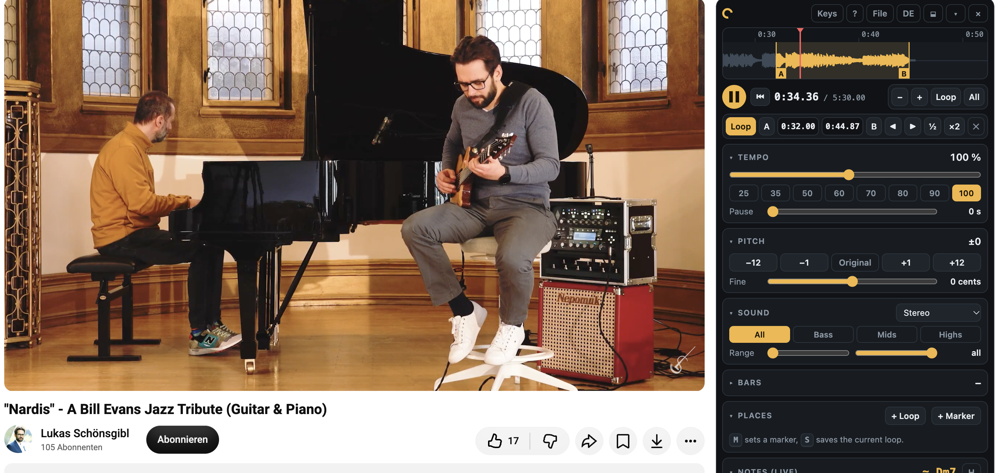
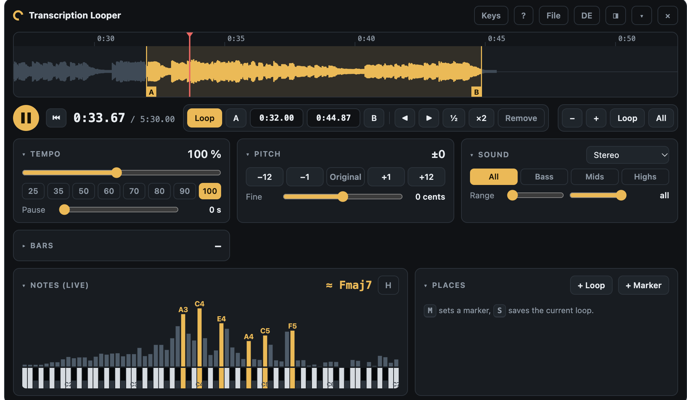
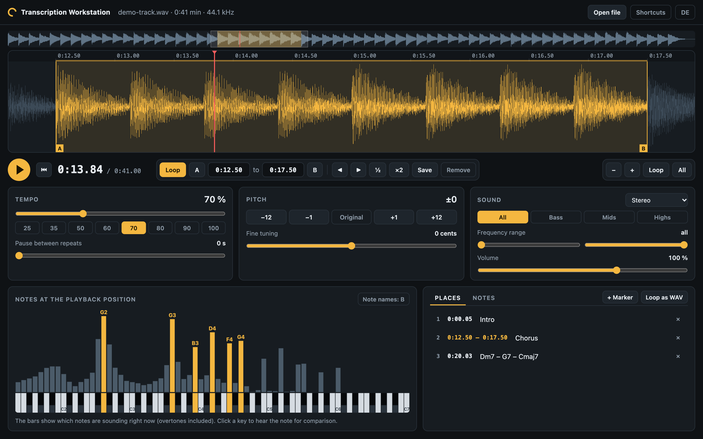

# Transcription Looper

**A Chrome extension for learning music by ear.** Loop a passage of a YouTube video or an audio file precisely, slow it down without changing the pitch, transpose it, filter out the bass and see which notes are sounding – all in your browser, nothing is uploaded.

[Deutsche Version](README.de.md) · [Download the latest release](https://github.com/hybridpicker/youtube-transcription-looper/releases/latest) · [Changelog](CHANGELOG.md)

It has two parts:

- **YouTube looper** – a panel right next to the video with a precise A/B loop, slow-down, transposition, tone filters, a bar grid, a live note display and saved places.
- **Transcription workstation** for audio files – the same tools with a real waveform and sample-accurate loops.

The interface is available in **English** and **German**. It follows your browser language; the `DE` / `EN` button switches it.

## Features

- **A/B loop** – drag a range in the timeline, fine-tune the edges, move the loop by its own length, halve or double it, add a pause between repeats.
- **Slow-down from 10 to 200 %** at the same pitch, also below YouTube's own 25 % limit, using a phase vocoder that sounds clean at slow tempos.
- **Pitch** ±12 semitones plus fine tuning in cents, independent of the tempo.
- **Sound** – left / right channel only, mono, center removed (often reduces the lead vocal or solo), and a frequency range filter, e.g. bass only.
- **Bar grid** – tap the tempo, set the one, see bar numbers in the timeline; set a loop as "bars 5 to 8".
- **Live notes** – a piano keyboard shows which notes are sounding and guesses the chord. Click a key to hear the note.
- **Places** – named markers and saved loops, remembered per video or file.
- **Workstation extras** – sample-accurate loops without clicks, notes with timestamps, export of the current loop as WAV.
- **Private by design** – no account, no tracking, no network requests of its own. See [PRIVACY.md](PRIVACY.md).

## Installation

The extension is not in the Chrome Web Store (yet). Installing it takes a minute:

1. Download `transcription-looper-<version>.zip` from the [latest release](https://github.com/hybridpicker/youtube-transcription-looper/releases/latest) and unzip it.
2. Open `chrome://extensions` in Chrome.
3. Turn on **Developer mode** (top right).
4. Click **Load unpacked** and choose the unzipped folder.
5. Pin the extension icon in the toolbar.

It works in Chrome and other Chromium-based browsers (Edge, Brave, Vivaldi, Arc).

**Update:** download the new release, replace the folder's contents and click the reload icon on the extension's card in `chrome://extensions`. Reload open YouTube tabs afterwards.

**From source:** clone this repository and choose the repository folder in step 4.

## YouTube looper

On a YouTube video page, click the extension icon: the panel appears next to the video, so picture and controls are visible together, and it stays in place while you scroll. It stays open for further videos until you close it with `×`.

The `⬓` button in the header moves the panel below the video instead (`◨` moves it back). In theater mode and in narrow windows without a sidebar it goes below the video automatically. Every section (Tempo, Pitch, Sound, Bars, Places, Notes) folds with a click on its heading. On any other page the icon opens the workstation for audio files.

| Section | What it does |
| --- | --- |
| Timeline | Click to jump, drag to draw a loop, drag the A/B handles to move its edges. A new loop is zoomed in automatically; **All** shows the whole video again, `Ctrl`/`⌘` + mouse wheel zooms freely. The waveform builds up while the video plays and shows what you have already heard. |
| Loop | Move by its own length, halve, double, nudge the edges, pause between repeats. `✕` removes the loop. |
| Tempo | 10–200 % at the same pitch. Click the percentage to reset to 100 %. |
| Pitch | ±12 semitones and fine tuning in cents, independent of the tempo. |
| Sound | Channel (left, right, mono, center removed) and frequency range, e.g. bass only. |
| Bars | Bar grid with bar numbers in the timeline; loop edges can be placed freely (hold `Alt` to snap to beats and bars), and a loop can be set as "bar 5 to 8". |
| Places | Markers (**+ Marker**) and saved loops (**+ Loop**) with names, remembered per video. |
| Notes | Shows live on a piano keyboard which notes are sounding and guesses the chord. Click a key to hear the note for comparison. |

Loop, tempo, pitch, grid, places, zoom and the waveform heard so far are saved per video, so a reload (also in the YouTube app window) picks up where you left off.

The keyboard shortcuts are the same as in the workstation (see below), plus `T` (tap tempo), `X` (set the one) and `G` (grid on/off). While the panel is open they take precedence over YouTube's own keys; the **Keys** button turns that off.

### Marking bars

The **Bars** section starts folded; click its heading to open it.

1. **Set the tempo:** let the video play and click **Tap** along with the beat (or press `T`) – at least two, better eight beats. Or type the BPM. This also works at reduced speed; the tempo always refers to the original.
2. **Set the one:** on the first beat of bar 1, click **1 here** (or press `X`). `◂` `▸` shift the grid by 10 ms (`Shift`: 50 ms).
3. **Time signature:** choose the beats per bar (default 4).

The timeline then shows bar lines with numbers instead of times, beats when zoomed in, and the section header shows the current bar and beat. Loop edges go exactly where you put them; hold `Alt` while dragging to snap them to beats and bars, **Grid** (`G`) hides it all. A loop that lies on bar lines moves bar by bar with `,` and `.`.

The grid is even. On recordings with a drifting tempo it gets out of step over time; set the one again at the passage you are working on.

### How the sound processing works

For slow-down and transposition, the video's sound runs through the extension's own phase vocoder instead of Chrome's built-in tempo correction. That sounds much cleaner at slow tempos, but delays the sound slightly against the picture (about 0.1 s, up to 0.35 s at very slow tempos). At 100 % and original pitch the sound is passed through unchanged and without delay.

### Good to know

- Sound processing (pitch, filters, note display, waveform) starts on its own as soon as Chrome allows it: usually right away on YouTube, otherwise after your first click or key press on the page. Loop and tempo work before that.
- When jumping back to the loop start, the YouTube player pauses for a tiny moment. For seamless, sample-accurate loops, use the workstation with an audio file.
- The looper does not interfere during ads.
- The panel is not visible in fullscreen; loop and shortcuts keep working.
- If the extension is reloaded while a YouTube tab is open, reload the tab.

## Transcription workstation (audio files)

Open it by clicking the extension icon on any non-YouTube page, or with **File** in the YouTube panel. Then drop a file into the window (MP3, WAV, FLAC, M4A, OGG; also video files with a sound track).

| Section | What it does |
| --- | --- |
| Waveform | Click to jump, drag to draw a loop, drag the A/B handles. Mouse wheel zooms, swiping sideways scrolls. The strip above shows the whole file. |
| Loop | Sample-accurate edges without clicks. Move by its own length, halve, double, pause between repeats. |
| Tempo | 10–200 % at the same pitch. At 100 % and original pitch the file plays unchanged. |
| Pitch | ±12 semitones and fine tuning in cents, independent of the tempo. |
| Sound | Channel (left, right, mono, center removed), frequency range and volume. |
| Notes | Shows on a piano keyboard which notes are sounding at the playback position and guesses the chord. Click a key to hear the note. |
| Places | Markers and saved loops with names; recall with a click or a number key. |
| Notes tab | A text field per file with timestamps, export as a text file. The current loop can be saved as WAV. |

Loop, tempo, markers and notes are remembered per file. The last opened file is loaded again on the next start (stored locally in the extension's browser storage).

### Keyboard shortcuts

| Key | Action |
| --- | --- |
| `Space` | Play / pause; with an active loop, playback always starts at the loop start |
| `Enter` | Jump to loop start and play |
| `←` `→` | 1 s back / forward (`Shift`: 5 s, `Alt`: 0.1 s) |
| `A` `B` | Loop start / end at the playback position |
| `L` | Loop on / off |
| `,` `.` | Move loop back / forward by its length |
| `H` `D` | Halve / double loop |
| `Q` `W` / `E` `R` | Loop start / loop end earlier / later (`Shift`: coarse) |
| `↑` `↓` | Tempo ±5 % |
| `+` `−` | Pitch ±1 semitone |
| `M` / `S` | Set marker / save loop |
| `1`–`9` | Recall saved place |
| `Z` / `F` | Zoom to loop / show the whole file |
| `?` | Show shortcuts |

In the notes field: `Shift`+`Space` play/pause, `Shift`+`Enter` to loop start, `Alt`+`T` insert timestamp.

### Good to know

- The chord display is an estimate from the spectrum and can be off because of overtones. Below about A1 the note resolution is coarse.
- Very long files need a lot of memory because they are decoded completely (about 25 MB per stereo minute).
- Without the extension, the workstation also runs from a local web server: run `python3 -m http.server 8791` in the repository folder and open `http://localhost:8791/app/`. Double-clicking `index.html` does not work.

## Note names

The note display uses international names (`B`) in English and German names (`H`) in German. The `B` / `H` button in the note section switches between them independently of the language.

## Development

There is no build step: the extension is plain JavaScript, HTML and CSS.

| File | Content |
| --- | --- |
| `manifest.json`, `_locales/` | Extension manifest; name and description in English and German |
| `background.js` | Toolbar icon: toggle the panel or open the workstation |
| `youtube/content.js`, `youtube/panel-css.js` | YouTube panel (content script, Shadow DOM) |
| `shared/common.js` | Shared helpers (time format, note names, chord estimate) |
| `shared/i18n.js` | All UI texts in English and German |
| `app/vocoder.js` | Phase vocoder with phase locking, shared by both parts |
| `app/live-core.js`, `app/live-worklet.js` | Live pitch shifter for the YouTube sound |
| `app/stretch-core.js`, `app/stretch-worklet.js` | File playback: time stretching, resampler, sample-accurate loops |
| `app/engine.js` | AudioWorklet and Web Audio wiring for the workstation |
| `app/analysis.js`, `app/fft.js` | Waveform data, note spectrum, WAV export |
| `app/app.js`, `app/index.html`, `app/app.css` | Workstation interface |
| `scripts/package.sh` | Builds the release ZIP in `dist/` |
| `scripts/demo-audio.py` | Writes a synthetic demo track for testing and screenshots |

Contributions are welcome – see [CONTRIBUTING.md](CONTRIBUTING.md). The original first version of the extension is kept in the Git history (last present in commit `93455e4`, folder `legacy-v1/`).

## License

[MIT](LICENSE) © 2026 Lukas Schönsgibl

Screenshots of the YouTube panel show ["Nardis" – A Bill Evans Jazz Tribute](https://www.youtube.com/watch?v=3jdUUfYXp3g) by the author, used with permission. The workstation screenshots use a synthetic demo track.

This project is not affiliated with or endorsed by YouTube or Google.
